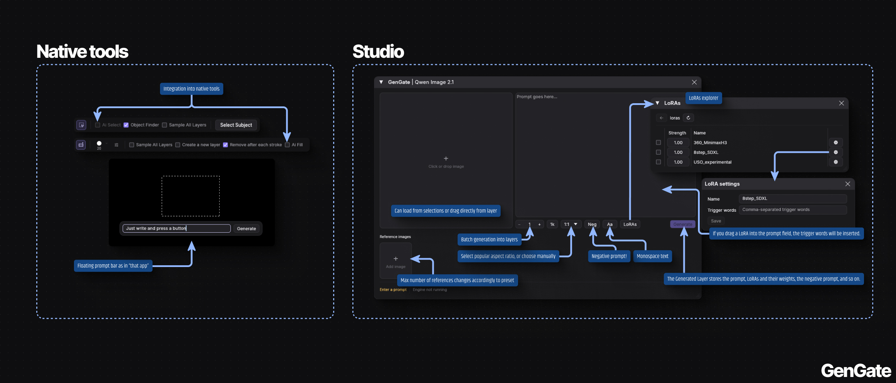
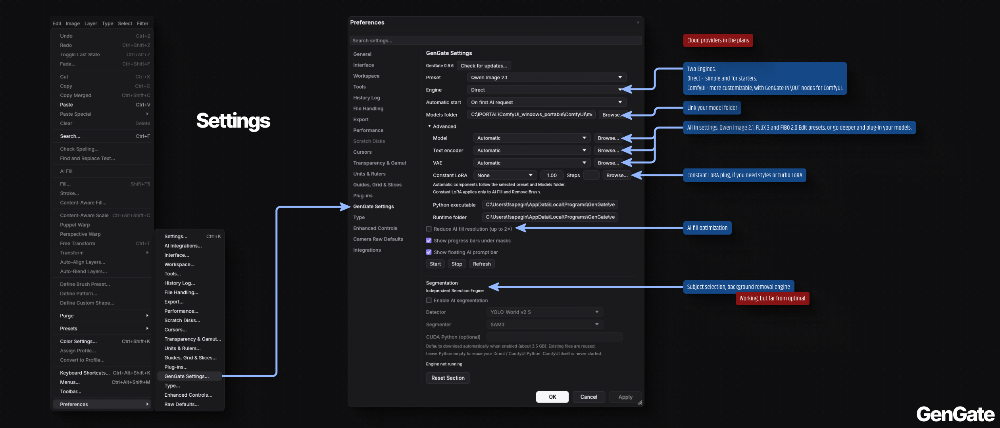

# GenGate
### Photocraft ai-gen studio

A work-in-progress suite for [PhotoCraft](https://github.com/storytold/photocraft), adding AI fill, selection and object removal, alongside a straightforward interface for image generation.

## Contents

[Features](#features) · [Tools](#tools-overview) · [WIP](#wip-status) · [Installation](#installation-guide) · [Settings](#settings-guide) · [Model files](#model-files) · [Development and licenses](#development-and-licenses)

## Features

- **Two engines:** Direct for users without ComfyUI, and ComfyUI for preset editing and custom Studio workflows.
- **ComfyUI workflows:** Studio runs the active graph open in ComfyUI, including unsaved changes; Ai Fill and Remove Brush use separate API workflow files. IN supplies both prompt texts, images and request values. Optional helpers apply selected LoRAs and native edit-step overrides. [Setup and ports](docs/COMFY_WORKFLOWS.md).
- **Floating Studio:** move the palette beyond the editor window or onto another monitor; its position and size are remembered.
- **Custom dimensions:** enter exact output width and height in the aspect-ratio list. Repeat generation keeps your original references.
- **Negative prompt:** Studio's Neg button splits the text area; both source texts are stored with generated layers and restored from them.
- **Updates:** a shared updater for PhotoCraft and GenGate that keeps engine settings and model folders, plus independent GenGate release notifications. [Updating safely](docs/UPDATES.md).
- **Preset-based setup:** compatible model components are selected automatically. Advanced settings let you choose your own model, text encoder, VAE and FLUX prompt upsampler, including INT8 and other supported formats.
- **Native tools, uncluttered workspace:** editing tools stay inside PhotoCraft; configuration lives in **Edit → Preferences → GenGate Settings**.
- **Constant LoRA:** an optional adapter with adjustable strength for Ai Fill and Remove Brush. It is separate from full image generation.
- **LoRA Explorer:** browse `models/loras`, set strengths, aliases and trigger words. Drag a LoRA into the prompt to append its triggers. Drag a layer into GenGate to reuse its image, prompt and adapter settings; reference slots accept just its image.
- **Optional economy mode:** small AI edits keep their original resolution; larger crops reduce progressively, by no more than 2×.

<a id="tools-overview"></a>

## Tools



| Tool | Where / what it does |
| --- | --- |
| **GenGate** | **Filter → Plugins → GenGate**. Text-to-image and reference-based generation, drag-and-drop references, prompt chips, batches and new layers. Works without an open document. |
| **Ai Fill** | Floating prompt bar or **Edit → Ai Fill**. Generate inside a selection; keep prompts and variants in layer Properties. |
| **AI Remove Brush** | Enable **Ai Fill** in the native Remove Tool. Paint an object to remove it; existing sampling and new-layer options still work. |
| **AI selection** | **Select Subject**, **Sky** and **Remove Background** use the independent selection engine when enabled. |
| **Ai Select** | Enable it in the native Object Selection Tool, then drag a rectangle around the subject. |

## WIP status

Work in progress:

- UI/UX refinements.
- Cloud provider integrations.

<a id="installation-guide"></a>

## Installation


**Windows x64 · NVIDIA CUDA GPU for local AI processing.**

Download **[GenGate 0.10.2](https://github.com/Philippsapegin/Photocraft_GenStudio/releases/tag/v0.10.2)** · [Windows add-on ZIP](https://github.com/Philippsapegin/Photocraft_GenStudio/releases/download/v0.10.2/GenGate-0.10.2-windows-x64-addon.zip) · [SHA-256](https://github.com/Philippsapegin/Photocraft_GenStudio/releases/download/v0.10.2/SHA256SUMS.txt).

1. Install PhotoCraft separately. Extract **GenGate-0.10.2-windows-x64-addon.zip** and run **Setup.cmd**. This add-on contains binary patches and its local host, **no complete PhotoCraft editor**.
2. Select your existing **PhotoCraft folder**, a separate GenGate installation folder and a **Models folder**. Reuse your `ComfyUI/models` directory or create a separate one. Models are used in place, without duplicate downloads.
3. **Install Direct engine** is enabled by default. It prepares a separate CUDA runtime (several GB) or reuses your previously configured compatible Direct runtime. Optionally select your **ComfyUI folder** and **ComfyUI Python** to configure both engines. Disable Direct only for a ComfyUI-only installation; both ComfyUI fields are then required. Choose the active engine later in PhotoCraft preferences.
4. Save and close PhotoCraft before installing. Open **PhotoCraft** from Start or the desktop and choose a **Preset** in **Preferences → GenGate Settings**. Setup consolidates the editor shortcuts and removes old GenStudio/GenGate launcher duplicates. Engine startup can be off, on application launch, or on the first AI request.

Run **Setup.cmd as your normal signed-in Windows user**, without **Run as administrator**. Keep the default GenGate folder under your own `%LOCALAPPDATA%\Programs`. When PhotoCraft is in Program Files or another protected folder, setup prepares a verified personal copy in `%LOCALAPPDATA%\Programs\ArtCraft\PhotoCraft-GenGate`, carries over your own profile, and points your PhotoCraft shortcut to that copy. The shared editor and other users' shortcuts stay unchanged. Direct is installed for the same account that will run generation.

For a fresh ArtCraft Launcher installation, selecting **portable ZIP** instead of **Installer (.msi)** puts PhotoCraft in your own profile and avoids the need for a second personal copy. Setup can also work directly with an existing writable portable installation.

You can run **Uninstall.cmd** from the installed folder or the complete extracted ZIP. Removal can optionally delete recovery backups after verifying the restored original executables. Only removal of a legacy system-wide patch may request administrator credentials; installing or updating the new personal copy does not.

[Release notes](docs/RELEASE_NOTES_0.10.2.md).

ComfyUI Studio runs the graph currently open in the browser. Ai Fill and Remove Brush have separate workflow files in Advanced. Explicit component choices override only titled GenGate loaders in the submitted graph copy; Automatic retains the graph's values. Update the nodes, restart ComfyUI and refresh its tab. [Setup, migration and LoRA wiring](docs/COMFY_WORKFLOWS.md).

**Compatibility (0.10.2 package):** official **PhotoCraft 0.23.1 Windows x64** binaries. For official PhotoCraft 0.22.0, use [GenGate 0.10.1](https://github.com/Philippsapegin/Photocraft_GenStudio/releases/tag/v0.10.1); for 0.21.0, use [GenGate 0.10.0](https://github.com/Philippsapegin/Photocraft_GenStudio/releases/tag/v0.10.0); for 0.20.2, use [GenGate 0.9.8](https://github.com/Philippsapegin/Photocraft_GenStudio/releases/tag/v0.9.8); for 0.20.1, use [GenGate 0.9.7](https://github.com/Philippsapegin/Photocraft_GenStudio/releases/tag/v0.9.7); for 0.18.0, use [GenGate 0.9.6](https://github.com/Philippsapegin/Photocraft_GenStudio/releases/tag/v0.9.6); for 0.17.0, use [GenGate 0.9.5](https://github.com/Philippsapegin/Photocraft_GenStudio/releases/tag/v0.9.5); for 0.16.0, use [GenGate 0.9.4](https://github.com/Philippsapegin/Photocraft_GenStudio/releases/tag/v0.9.4). Other builds need separate patch adaptation. Setup checks file hashes and refuses unknown builds. It never downgrades an updated editor.

To update GenGate, close PhotoCraft and run Setup into the same **GenGate** folder. The editor's existing profile is preserved. The PhotoCraft shortcut checks for replaced editor files and reapplies a compatible patch; an unknown PhotoCraft update opens normally with a compatibility notice and requires an updated GenGate patch.

If Setup finds an older PhotoCraft, choose **Update PhotoCraft**. It downloads and verifies the supported official release, waits for you to save and close the editor, then updates PhotoCraft and applies GenGate with your saved settings. The editor's **Update and Restart** action opens this same helper. If the offered PhotoCraft version needs a newer GenGate, update GenGate first. See [update details](docs/UPDATES.md).

Run **Uninstall.cmd** in the GenGate folder to restore the original editor. Newer PhotoCraft files, documents and shared models are kept. Software files and recovery backups are retained for reinstalling or manual removal.

<a id="settings-guide"></a>

## Settings



Open **Edit → Preferences → GenGate Settings** to select the preset, active engine, model folder and startup policy. **Advanced** contains model components, workflow files and runtime paths. Constant LoRA and its optional Steps override apply to native editing tools; Studio retains its own generation recipe. AI selection has independent controls in the Segmentation section.

## Model files

Download the components for the preset you want. Use the linked single-file checkpoints, not a full Diffusers repository. Choose **one** Qwen text encoder; W4A8 is the smaller recommended option.

**Qwen Image 2.1**

| Component | File | Download |
| --- | --- | --- |
| Model | `qwen_image_2.1_turbo_int8_convrot.safetensors` | [INT8 · 7.26 GB](https://huggingface.co/Comfy-Org/Qwen-Image-2.1/resolve/72a49122613a4f9afbcc443426d6c765c0c383cf/diffusion_models/qwen_image_2.1_turbo_int8_convrot.safetensors?download=true) |
| Text encoder — recommended | `qwen3vl_8b_w4a8.safetensors` | [W4A8 · 6.31 GB](https://huggingface.co/Comfy-Org/Qwen-Image-2.1/resolve/72a49122613a4f9afbcc443426d6c765c0c383cf/text_encoders/qwen3vl_8b_w4a8.safetensors?download=true) |
| Text encoder — alternative | `qwen3vl_8b_int8_convrot.safetensors` | [INT8 · 9.35 GB](https://huggingface.co/Comfy-Org/Qwen-Image-2.1/resolve/72a49122613a4f9afbcc443426d6c765c0c383cf/text_encoders/qwen3vl_8b_int8_convrot.safetensors?download=true) |
| Text encoder — full precision | `qwen3vl_8b_bf16.safetensors` | [BF16 · 17.53 GB](https://huggingface.co/Comfy-Org/Qwen-Image-2.1/resolve/72a49122613a4f9afbcc443426d6c765c0c383cf/text_encoders/qwen3vl_8b_bf16.safetensors?download=true) |
| VAE | `qwen_image_2.1_vae_bf16.safetensors` | [BF16 · 0.68 GB](https://huggingface.co/Comfy-Org/Qwen-Image-2.1/resolve/72a49122613a4f9afbcc443426d6c765c0c383cf/vae/qwen_image_2.1_vae_bf16.safetensors?download=true) |

**FLUX 3**

| Component | File | Download |
| --- | --- | --- |
| Model | `flux3-image-klein-int8-convrot.safetensors` | [INT8 · 5.83 GB](https://huggingface.co/ml-resources/flux-3-image-klein-comfy/resolve/3ba0f7064cbb1666a71e2820d3cc5c2273bb6cd0/diffusion_models/flux3-image-klein-int8-convrot.safetensors?download=true) |
| Text encoder | `qwen3vl_4b_int8_convrot.safetensors` | [INT8 · 4.86 GB](https://huggingface.co/ml-resources/flux-3-image-klein-comfy/resolve/3ba0f7064cbb1666a71e2820d3cc5c2273bb6cd0/text_encoders/qwen3vl_4b_int8_convrot.safetensors?download=true) |
| Prompt upsampler | `qwen3.5_9b_flux3_prompt_upsampler_w4a8.safetensors` | [W4A8 · 6.72 GB](https://huggingface.co/ml-resources/flux-3-image-klein-comfy/resolve/3ba0f7064cbb1666a71e2820d3cc5c2273bb6cd0/text_encoders/qwen3.5_9b_flux3_prompt_upsampler_w4a8.safetensors?download=true) |
| VAE | `flux2-vae.safetensors` | [0.34 GB](https://huggingface.co/ml-resources/flux-3-image-klein-comfy/resolve/3ba0f7064cbb1666a71e2820d3cc5c2273bb6cd0/vae/flux2-vae.safetensors?download=true) |

**FIBO 2.0 Edit Turbo**

Four-step editing with up to four references, using plain instructions or VGL JSON. Add an image to edit; this preset does not offer text-to-image. Advanced discovery selects Turbo, not Dev. Encoder and VAE are shared with FLUX where already installed.

| Component | File | Download |
| --- | --- | --- |
| Model | `fibo2_edit_turbo_int8_convrot.safetensors` | [INT8 · 8.41 GB](https://huggingface.co/Comfy-Org/Fibo-2.0/resolve/b2bffaf57d48825a6989b986f24d5cfb8c71231b/diffusion_models/fibo2_edit_turbo_int8_convrot.safetensors) |
| Text encoder | `qwen3vl_4b_int8_convrot.safetensors` | [INT8 · 4.86 GB](https://huggingface.co/Comfy-Org/Fibo-2.0/resolve/b2bffaf57d48825a6989b986f24d5cfb8c71231b/text_encoders/qwen3vl_4b_int8_convrot.safetensors) |
| VAE | `flux2-vae.safetensors` | [0.34 GB](https://huggingface.co/Comfy-Org/Fibo-2.0/resolve/b2bffaf57d48825a6989b986f24d5cfb8c71231b/vae/flux2-vae.safetensors) |

FIBO weights are CC BY-NC 4.0; commercial use requires an agreement with Bria. See the [publisher's model card](https://huggingface.co/briaai/Fibo-2.0-edit-turbo).

**Independent Selection Engine**

| Component | Download |
| --- | --- |
| YOLO-World v2 S | [Official weights · 25.9 MB](https://github.com/ultralytics/assets/releases/download/v8.4.0/yolov8s-worldv2.pt) |
| SAM3 | [Official model and terms](https://huggingface.co/facebook/sam3) · [pinned third-party mirror · 3.45 GB](https://huggingface.co/AB498/sam3/resolve/84bd0040bde4d9dd9312dd8beab0d15068d95ce8/sam3.pt) |

Enabling AI segmentation downloads its selected components automatically and reuses existing files.

### Models folder

```text
models/
  diffusion_models/   # Qwen / FLUX / FIBO image model
  text_encoders/      # Text encoder and FLUX prompt upsampler
  vae/               # VAE
  loras/             # Optional adapters, selected manually
  segmentation/      # YOLO-World and SAM3 .pt files
```

All presets can share this folder. Nested folders, `unet` / `clip` aliases and a flat folder also work. If discovery misses a component, select it using **Advanced → Browse**. Sizes above are download sizes, not VRAM requirements.

## Development and licenses

See [development and packaging](docs/DEVELOPMENT.md), [architecture](docs/ARCHITECTURE.md), [validation](docs/VALIDATION.md) and [third-party notices](THIRD_PARTY.md).

Python host, adapters and installer: **GPL-3.0-or-later** ([LICENSE](LICENSE)). Original Rust integration: **MIT OR Apache-2.0**, matching PhotoCraft ([MIT](photocraft/LICENSE-MIT), [Apache-2.0](photocraft/LICENSE-APACHE)). Ultralytics uses AGPL-3.0 and runs in a separate process. Model weights retain their publishers' terms.
